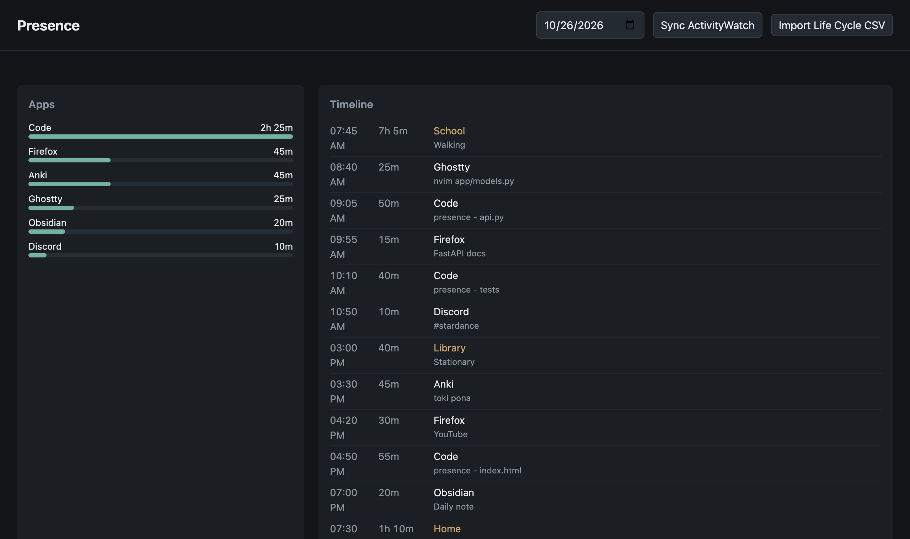

# Presence

A local dashboard that puts your desktop app usage and the places you've been on one daily timeline.

Presence pulls window activity from [ActivityWatch](https://activitywatch.net) and imports location visits from the [Life Cycle](https://northcube.com/lifecycle/) iOS app's CSV export. Everything is stored in a SQLite file on your machine. Nothing is sent anywhere.

I wanted one place to see where my day went without stitching together three apps. This is Phase 1 of that idea; the rest is in the roadmap below.



The screenshot uses demo data.

## Features

- **ActivityWatch sync**: pulls every `currentwindow` bucket for the chosen day. Re-syncing only adds new events.
- **Life Cycle import**: upload a CSV export; visits show up on the timeline. Re-importing the same file adds nothing.
- **Per-app totals** for the day, as bars.
- **Merged timeline** of app sessions and place visits, sorted by start time.
- **Day picker** to look back at any day you have data for.
- JSON API for all of the above (`/docs` has the interactive OpenAPI page).

## Quick start

Needs Python 3.11 or newer. ActivityWatch is optional; without it the sync button reports that it can't connect and CSV import still works.

```sh
git clone https://github.com/tundra-node/presence.git
cd presence
python3 -m venv .venv
.venv/bin/pip install -r requirements.lock
.venv/bin/uvicorn app.main:app --port 8000
```

Open http://localhost:8000. Click **Sync ActivityWatch** to pull today's activity, or **Import Life Cycle CSV** to load a location export.

### Tests

```sh
.venv/bin/pytest
.venv/bin/ruff check .
```

The tests mock ActivityWatch, so they run without it installed.

## Configuration

Set these as environment variables before starting uvicorn.

| Variable | Default | Purpose |
|---|---|---|
| `PRESENCE_DB` | `data/presence.db` | SQLite database path. Created on first run. |
| `PRESENCE_AW_URL` | `http://localhost:5600` | ActivityWatch server URL. |
| `PRESENCE_AW_TIMEOUT` | `10` | Seconds to wait for ActivityWatch. |

## Life Cycle CSV format

Headers are matched loosely (case, spaces and punctuation ignored). A row needs:

- a start column (`START DATE(UTC)`, `Start Date`, `Start`, ...)
- an end column (`END DATE(UTC)`, `End`, ...) or a duration in seconds or `h:mm:ss`
- a place name (`Display Name`, `Name`, `Location`, `Place`)

`Activity`, `Latitude` and `Longitude` are picked up if present. Timestamps in a column with "UTC" in the header are read as UTC; other timestamps without an offset are read as local time. ISO 8601, `YYYY-MM-DD HH:MM[:SS]`, `MM/DD/YYYY HH:MM [AM/PM]` and `DD.MM.YYYY HH:MM` all work. If your export fails, the error names the line and the columns it found.

## API

| Method | Path | Description |
|---|---|---|
| GET | `/api/health` | Liveness check |
| POST | `/api/sync/activitywatch?day=YYYY-MM-DD` | Pull window events for a day (default today) |
| GET | `/api/activity?day=` | Events and per-app totals |
| POST | `/api/import/lifecycle` | Multipart upload, field `file` (20 MB max) |
| GET | `/api/places?day=` | Visits overlapping the day |
| GET | `/api/timeline?day=` | Activity and visits merged |

Days are local calendar days on the machine running Presence.

## Project layout

```
presence/
├── app/
│   ├── main.py               # FastAPI app factory, static files
│   ├── config.py             # Environment variable settings
│   ├── models.py             # SQLite schema and queries
│   ├── routes/api.py         # JSON endpoints
│   ├── imports/
│   │   ├── activitywatch.py  # ActivityWatch REST client
│   │   └── lifecycle.py      # Life Cycle CSV parser
│   └── static/index.html     # Dashboard (vanilla JS)
├── data/                     # SQLite DB lives here (gitignored)
├── docs/screenshot.png
├── tests/
├── requirements.txt          # Direct dependencies
├── requirements-dev.txt      # + pytest, ruff
└── requirements.lock         # Pinned versions (uv pip compile)
```

## Roadmap

- **Phase 1, done**: ActivityWatch sync, Life Cycle import, daily timeline, SQLite.
- **Phase 2**: Chrome extension that sends the active tab to Presence.
- **Phase 3**: Daily check-in (mood, sleep, habits) and calendar from my Obsidian vault.
- **Phase 4**: Patterns, like "you usually spend 45 minutes on FBLA study", and suggested schedules.

Presence is local and single-user. The server has no authentication, so keep it bound to localhost (the uvicorn default).

## AI usage

I planned the project and the scaffold. The Phase 1 implementation, tests and this README were written with help from an AI coding agent (Claude, via opencode).

## License

MIT. See [LICENSE](LICENSE).
